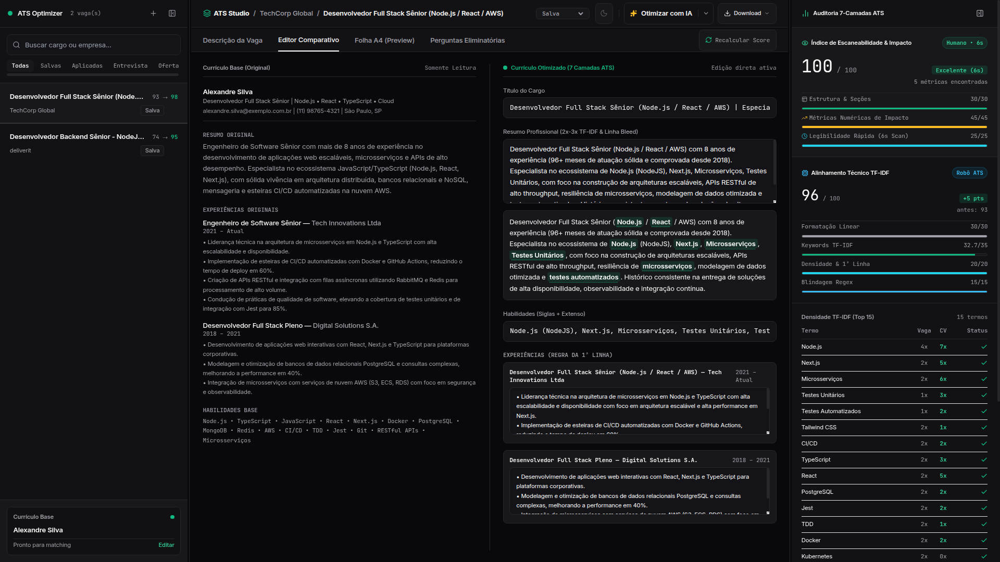

# ATS Resume Optimizer & Job Tracker

[](https://github.com/rslucena/ats-resume-optimizer/actions/workflows/ci.yml)
[](https://github.com/rslucena/ats-resume-optimizer)
[](https://bun.sh)
[](https://www.typescriptlang.org/)
[](LICENSE)

Aplicacao Full-Stack local-first desenvolvida para controle de candidaturas, otimizacao algoritmica de curriculos e geracao de cartas de apresentacao, aplicando engenharia reversa nas regras de parsers e extratores de ATS corporativos (Workday, Taleo, Greenhouse, Lever, Gupy, SAP SuccessFactors).



---

## Por que Local-First?

| Caracteristica | ATS Resume Optimizer | Plataformas SaaS Tradicionais |
| :--- | :--- | :--- |
| Privacidade | 100% Local (SQLite em disco sem telemetria) | Curriculos e dados enviados para servidores de terceiros |
| Modelo de Custo | Gratuito e Open-Source (MIT) | Mensalidades recorrentes e creditos pagos por download |
| Motores de Otimizacao | Hibrido: Motor 7-Camadas (offline), Ollama (local) ou Gemini | Geracao opaca por LLMs em nuvem sem auditoria de densidade |
| Carta de Apresentacao | Gerador contextual deterministico em 3 tons (PDF e DOCX) | Modelos genericos alucinados e sem alinhamento com a vaga |
| Formatacao ATS | PDFKit Linear + DOCX OpenXML com metadados XMP | Modelos visuais em duas colunas rejeitados por parsers |
| Rastreabilidade | Banco SQLite local auditavel via SQL | Dados retidos em plataformas fechadas |

---

## Principais Funcionalidades

### 1. Motor Algoritmico de 7 Camadas ATS (100% Deterministico)
- Reescrita balanceada baseada em analise de frequencia de termos e densidade TF-IDF.
- Enriquecimento contextual do resumo, experiencia e primeira linha de cada cargo sem inventar empresas ou graduacoes.
- Blindagem contra cortes eliminatorios com sinonimos tecnicos (ex: Node.js / NodeJS, Kubernetes / K8s).

### 2. Suporte Hibrido a LLMs (Ollama Local & Gemini Cloud)
- Suporte a LLMs locais e privadas via Ollama (Llama 3.2, Mistral, Gemma 2, DeepSeek-R1) com zero envio de dados para a internet.
- Suporte opcional ao Google Gemini 1.5 Flash via API Key.
- Arquitetura de fallback gracioso: se o motor de IA falhar ou estiver offline, a aplicacao recorre instantaneamente ao motor deterministico local de 7 camadas sem interromper o fluxo de trabalho.
- Seletor de motor integrado com dropdown sincronizado entre o cabecalho e os estúdios de edicao.

### 3. Cover Letter Studio (Cartas de Apresentacao ATS-Ready)
- Geracao de cartas de apresentacao altamente direcionadas a vaga e ao perfil do candidato.
- 3 tons profissionais pre-calibrados:
  - Tecnico & Direto: Foco em stack, arquitetura, resolucao de problemas e metricas.
  - Executivo: Foco em lideranca tecnica, gestao de riscos e impacto no negocio.
  - Entusiasta: Foco em alinhamento cultural, motivacao e afinidade com o produto.
- Exportacao direta para formatos PDF e DOCX com metadados XMP/coreProperties.

### 4. Gerador de Respostas para Perguntas Eliminatorias (Knockout Questions)
- Modulo para redigir respostas precisas a questoes de triagem (ex: "Qual sua experiencia pratica com microsservicos e testes unitarios?").
- Baseado estritamente nas evidencias comprovadas do perfil mestre e nos requisitos tecnicos da vaga.

### 5. Auditoria Dual-Score em Tempo Real
- Indice de Escaneabilidade & Impacto (Humano - regra dos 6 segundos): Estrutura de secoes (30 pts), metricas numericas de impacto (45 pts) e legibilidade rapida (25 pts).
- Alinhamento Tecnico TF-IDF (Robo ATS): Formatacao linear (30 pts), densidade de palavras-chave (35 pts), densidade da primeira linha (20 pts) e blindagem regex (15 pts).

### 6. Exportacao Binaria Multi-Formato
- PDF Linear: Construido com layout em coluna unica compativel com parsers, sanitizacao de dados sensiveis (LGPD) e metadados XMP embutidos no binario via pdf-lib.
- DOCX Microsoft Word: Gerado com propriedades OpenXML nativas.
- Texto Puro (TXT) e Markdown: Para preenchimento rapido em formularios web.
- JSON Resume: Padrao aberto de interoperabilidade de curriculos.

---

## Destaques da Arquitetura & Tech Stack

- Runtime: Bun com motor HTTP nativo de alta performance via Hono.
- Banco de Dados Local-First: SQLite nativo (bun:sqlite) operado atraves do Drizzle ORM com inicializacao e migracoes automaticas de schema (master_profiles, jobs, tailored_resumes, knockout_questions, cover_letters).
- Motor de NLP & Extracao Matematica:
  - natural: natural.TfIdf para medicao real de frequencia de termos e PorterStemmerPt / PorterStemmer para extracao de radicais morfologicos.
  - franc: Deteccao automatica do idioma da vaga (Portugues PT-BR vs. Ingles EN) adaptando stopwords e stemmers dinamicamente.
  - leven: Medicao de distancia de Levenshtein para tolerancia a variacoes lexicais.
  - Tech-First NER & Synonyms: Dicionario canonico com mais de 280 tecnologias modernas e mapeamento de grupos sinonimos (ex: Postgres / PostgreSQL, React / React.js).
- Motores de IA & Inferencia Local:
  - Ollama: Integracao local HTTP para execucao privada de LLMs sem conexao com a nuvem.
  - Google Gemini API: Integracao opcional via Google AI Studio com prompts estritos anti-alucinacao.
- Extracao & Geracao de Documentos:
  - pdf-parse: Extracao de texto de PDFs com reflow inteligente de quebras de linha visuais.
  - pdfkit + pdf-lib: Renderizacao vetorial de layout linear ATS com injecao binaria de Info Dictionary e XMP Metadata.
  - docx: Montagem de pacotes OpenXML compativeis com Word, LibreOffice e Google Docs.
- Scraping de Vagas: cheerio com normalizacao de espacamento e corte de secoes de boilerplate institucional.
- Frontend SPA: Interface industrial Dark Mode de alto contraste, visualizacao interativa de densidade TF-IDF, comparacao lado a lado (Master CV vs. Tailored CV) e Cover Letter Studio.

---

## As 7 Camadas Algoritmicas de Otimizacao ATS

Ao personalizar um curriculo para uma vaga, o motor cruza o perfil mestre aplicando:

1. Alinhamento de Densidade via natural.TfIdf:
   - Resumo Profissional: Repete as principais palavras-chave de 2x a 3x.
   - Titulo do Cargo: Iguala ao titulo da vaga e repete de 2x a 2.5x ao longo do curriculo.
   - Experiencias Profissionais: Insere as hard skills com repeticao contextualizada de 2x.
   - Habilidades: Garante presenca balanceada de 1.5x a 2x no documento.
   - Educacao: Repete o requisito de escolaridade ao menos 1x.

2. Pesos de Secao e Regra da Primeira Linha:
   - Peso 3 (Maximo): Resumo e Objetivo Profissional.
   - Peso 2 (Alto): Titulo do Cargo e a primeira linha de cada experiencia profissional, reescrita como um resumo executivo denso cravando cargo, tecnologia e resultado numerico.
   - Peso 1 (Medio): Bullets secundarios e listagem de skills.

3. Blindagem contra Corte Eliminatorio (Entity Extraction & Stemming):
   - Variacoes explicitas de tempo de experiencia: "5 anos de experiencia (60+ meses de atuacao solida e comprovada desde 2021)".
   - Variacoes de formacao: "Graduacao completa / Bacharelado / Ensino Superior em...".
   - Siglas + Extenso: "Node.js (NodeJS)", "TypeScript (TS)", "CI/CD (Integracao Continua)", "Kubernetes (K8s)".

4. Otimizacao de Espaco Vetorial (NLP Embeddings):
   - Substituicao de termos genericos por vocabulario tecnico denso do cluster da stack (throughput, microsservicos escalaveis, APIs RESTful, observabilidade, alta disponibilidade).

5. Exploracao do Bug de Janela Regex (Boundary Bleed):
   - Injecao estrategica no final do Resumo Profissional (colado na quebra da secao de Experiencias) contendo os requisitos mais pesados da vaga ("Core Stack & Especialidades: ...").

6. Injecao de Metadados Ocultos no Binario (pdf-lib e docx):
   - Gravacao interna no Info Dictionary e XMP stream:
     - Title (dc:title): Titulo exato da vaga.
     - Author (dc:creator): Nome do candidato.
     - Keywords (cp:keywords): Lista separada por virgula com as top keywords TF-IDF.
     - Subject (cp:description): Mini-resumo espelhando a vaga.
     - Creator / Category: "Curriculo".
   - Identica gravacao nas coreProperties do arquivo .docx.

7. Auditor de Score ATS Local (Antes vs. Depois):
   - Calculo em tempo real do Dual-Score (Escaneabilidade Humana e Alinhamento Maquina) com visualizacao comparativa e chips de frequencia.

---

## Como Executar

### 1. Pre-requisito
- Runtime Bun instalado (versao 1.2 ou superior).

### 2. Instalacao das dependencias
```bash
bun install
```

### 3. Rodar os Testes Automatizados (61 testes)
```bash
bun test
```

### 4. Iniciar o Servidor de Desenvolvimento
```bash
bun run dev
```

Acesse no navegador: `http://localhost:3000`

---

## Configuracao Opcional de Motores de IA (.env)

O sistema opera 100% offline utilizando o motor matematico deterministico por padrao, sem necessidade de chaves externas.

Para habilitar motores adicionais de IA, crie ou edite o arquivo `.env`:

```env
# Porta do servidor HTTP (Padrao: 3000)
PORT=3000

# Caminho do banco SQLite (Padrao: data/ats_tracker.sqlite)
DB_PATH=data/ats_tracker.sqlite

# Opcional: Chave da Google Gemini API para reescrita via nuvem
GEMINI_API_KEY=

# Opcional: URL do servidor Ollama para inferencia local privada (Padrao: http://localhost:11434)
OLLAMA_BASE_URL=

# Opcional: Modelo local a ser utilizado pelo Ollama (Padrao: llama3.2)
OLLAMA_MODEL=llama3.2
```

---

## Estrutura de Arquivos

```
├── data/                         # Banco de dados SQLite persistente (ats_tracker.sqlite)
├── public/                       # Interface SPA Dark Mode (HTML, CSS e JS modular)
├── screenshot_demo.png           # Screenshot da bancada de trabalho
├── src/
│   ├── api/
│   │   └── routes.ts             # Rotas REST Hono (Upload, Jobs, Tailoring, Cover Letters, Health)
│   ├── db/
│   │   ├── index.ts              # Conexao bun:sqlite e auto-migracoes Drizzle
│   │   └── schema.ts             # Schemas SQLite (master_profiles, jobs, cover_letters, etc.)
│   ├── documents/
│   │   ├── coverLetterDocx.ts    # Gerador DOCX para Cartas de Apresentacao
│   │   ├── coverLetterPdf.ts     # Gerador PDF linear para Cartas de Apresentacao
│   │   ├── docx.ts               # Gerador DOCX de Curriculo com OpenXML coreProperties
│   │   ├── jsonResume.ts         # Exportacao no padrao JSON Resume
│   │   ├── markdown.ts           # Exportacao em Markdown formatado
│   │   ├── pdf.ts                # Gerador PDFKit linear + injecao binaria XMP com pdf-lib
│   │   └── txt.ts                # Exportacao em texto puro UTF-8
│   ├── nlp/
│   │   ├── language.ts           # Deteccao PT-BR / EN com franc
│   │   ├── similarity.ts         # Proximidade lexica com leven
│   │   ├── stemmer.ts            # Stemmers com PorterStemmerPt e PorterStemmer
│   │   ├── stopwords.ts          # Stopwords tecnicas PT / EN
│   │   └── tfidf.ts              # Motor matematico natural.TfIdf, NER e sinonimos
│   ├── optimizer/
│   │   ├── scorer.ts             # Auditor Dual-Score (Escaneabilidade e TF-IDF)
│   │   └── tailor.ts             # Motor algoritmico das 7 camadas de ATS
│   ├── services/
│   │   ├── aiTailorService.ts    # Orquestrador de reescrita via IA (Gemini / Ollama / Local)
│   │   ├── coverLetterService.ts # Gerador de Cartas de Apresentacao em 3 tons
│   │   ├── cvExtractor.ts        # Extracao de texto de PDF, reflow e estruturacao
│   │   ├── jobScraper.ts         # Scraping e parsing de vagas com cheerio
│   │   ├── knockoutAnswerService.ts # Gerador de respostas para questoes eliminatorias
│   │   └── ollamaService.ts      # Cliente HTTP de integracao com Ollama local
│   ├── types/
│   │   └── resume.ts             # Tipagens TypeScript compartilhadas
│   ├── utils/
│   │   ├── dateFormat.ts         # Formatacao e normalizacao de datas
│   │   ├── encoding.ts           # Sanitizacao UTF-8 e limpeza de boilerplate
│   │   └── env.ts                # Leitura e sanitizacao de variaveis de ambiente
│   └── server.ts                 # Servidor Bun.serve + Hono
└── tests/                        # Suite completa de testes automatizados com bun test
```

---

## Licenca

Este projeto esta sob a licenca MIT. Consulte o arquivo [LICENSE](LICENSE) para obter mais informacoes.
